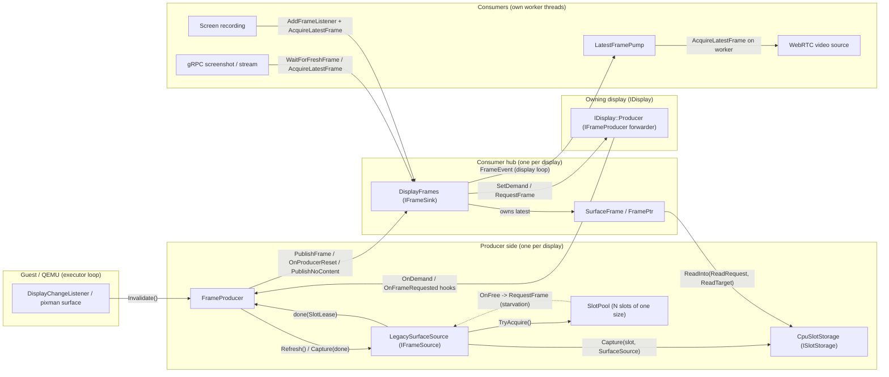
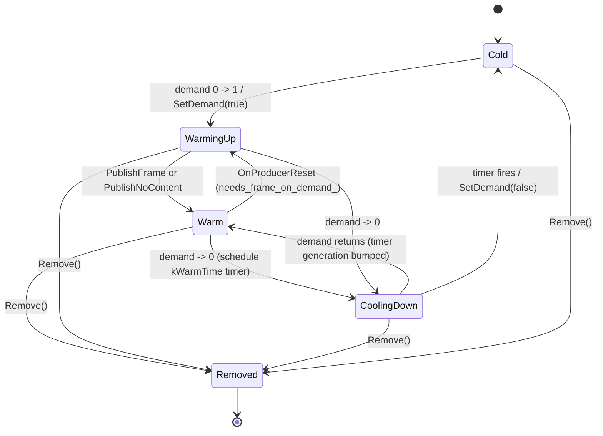
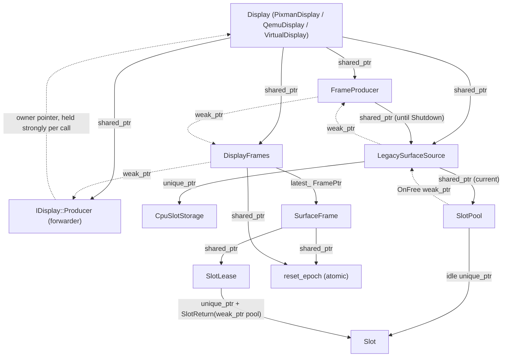

# Display Pipeline Design

`//emulator/libs/display_pipeline` moves guest display content to host consumers
(WebRTC video, gRPC screenshots, screen recording, and so on). It separates
**capturing** a guest frame from **reading** it. A producer copies guest pixels
into a bounded pool of immutable _slots_. Each consumer then pulls the latest
frame on its own thread and reads it with its own crop, rotation, scale, and
pixel format.

Namespace: `goldfish::display`. Public headers live in
[`include/goldfish/display/`](include/goldfish/display/).

## 1. Background, Goals, and Non-Goals

### 1.1 Background: What This Replaced

**How frames reach the plugin.** For a QEMU display, all of this runs on the
QEMU main loop with the BQL held:

1. `SET_SCANOUT` → `dpy_gfx_replace_surface` → `grpc_dpy_gfx_switch` →
   `QemuDisplay::OnSurfaceSwitch`. This runs on every page flip, because each
   guest buffer has its own console surface. A disabled scanout or a device
   reset switches to a _placeholder_ surface.
2. `RESOURCE_FLUSH` → the device reads the scanout back into the console surface
   synchronously → `grpc_dpy_gfx_update` (placeholders ignored) →
   `QemuDisplay::OnGuestFrame` → `FrameProducer::Invalidate()` → an inline copy
   into a slot (§5.2).
3. The DCL callbacks carry only a `DisplaySurface`. `QemuDisplay` registers its
   DCL only while warm (§12).

**What it replaced.** `PixmanFrameManager` kept one mutable image per display,
filled under a lock on the QEMU loop and exposed through `FrameInfo::pixels` and
`IDisplay::GetPixels`. Its consumer-visible defects, and the mechanism that
fixes each:

| Legacy defect                                                                                                                                                                                                           | Fix here                                                                              |
| :---------------------------------------------------------------------------------------------------------------------------------------------------------------------------------------------------------------------- | :------------------------------------------------------------------------------------ |
| **Torn frames.** `FrameInfo::pixels` pointed into the one shared image; the next flush overwrote it while consumers still read it.                                                                                      | Immutable slots behind a `SlotLease`; the producer never writes a leased slot (§4.2). |
| **Use-after-free on resize.** A resize freed the image while queued closures still held the raw pointer.                                                                                                                | Leases keep slots alive; reset epochs fence stale reads (§6.5).                       |
| **Rotation looked like a new frame.** `SetRotation` bumped the sequence number, so fold waiters woke early.                                                                                                             | Rotation re-emits the same `frame_id` (§6.6).                                         |
| **No reliable fresh frame.** `getScreenshot` added a throwaway listener and slept up to 250 ms; `streamScreenshot` polled with a lost-frame race.                                                                       | `WaitForFreshFrame` and warmth (§6.1, §6.2).                                          |
| **Implicit demand.** Screen recording polled `GetPixels` without subscribing, so it saw live content only if another consumer kept the display warm.                                                                    | Reference-counted demand (§6.2).                                                      |
| **Pixels on shared loops and locks.** Every flush copied the frame a second time under a mutex `GetPixels` also took; rotation used scalar loops (~6.1 ms per quarter turn); WebRTC converted NV12 inside the listener. | One copy at capture; libyuv transforms on the consumer's own thread (§7, §8.3).       |
| **Silent removal.** Erased displays lived on through `shared_ptr`s, and streams just went quiet.                                                                                                                        | Sticky `removed` plus a final event (§6.7, §6.8).                                     |
| **Per-frame destination allocation.** WebRTC allocated a 3.93 MB `NV12Buffer` per frame (246 page faults, ~230 µs).                                                                                                     | Caller-owned `ReadTarget`s that the caller can pool (§8.2, §12.1).                    |

Slots do not reduce the QEMU-loop readback, which happens before the plugin is
called (§17.4). Design decisions and rejected alternatives are in §15.

### 1.2 Terminology

| Term             | Meaning                                                                                                           |
| :--------------- | :---------------------------------------------------------------------------------------------------------------- |
| **Display**      | An `IDisplay`: one QEMU scanout (`QemuDisplay`), a `PixmanDisplay`, or a `VirtualDisplay`.                        |
| **Frame**        | An immutable snapshot of one display, held as a `FramePtr`.                                                       |
| **Slot / lease** | Producer storage for one frame / read-only ownership of it. The producer never writes a leased slot.              |
| **Warm / cold**  | Warm: demand exists and the producer has delivered since demand started or the last reset. Cold: no capture work. |
| **Blank frame**  | A frame with no slot that reads as opaque black.                                                                  |
| **Event**        | A `FrameEvent`: metadata meaning "a newer frame exists". Never pixels.                                            |
| **Display loop** | The `EventLoop` given to `IDisplay`; listener callbacks run there.                                                |
| **Executor**     | The loop `FrameProducer` pumps on, normally the QEMU main loop.                                                   |

### 1.3 Goals

1. **No work without demand.** The display does no capture work unless a
   consumer wants frames. Demand is reference-counted, and a short warm window
   stops polling clients from paying the cold-start cost on every request. A
   warm 1080×2424 QEMU display costs the QEMU loop about 0.6 ms per flush
   (§17.4); what a cold display saves has not been measured.
2. **Latest wins, bounded memory.** At most one capture is in flight per
   display. Bursts of guest flushes and consumer requests collapse into a single
   follow-up capture. Slot memory per display is capped by a fixed pool size.
3. **Immutable, shareable frames.** A published frame never changes. Several
   consumers can read the same frame at once, each with a different
   `ReadRequest`.
4. **Zero-allocation reads.** Consumers write directly into memory they own
   (protobuf strings, `mmap` regions, WebRTC buffers). Scratch memory for
   intermediate steps is pooled. A fresh WebRTC buffer per frame cost about 230
   µs in page faults (§17.3).
5. **Reset safety.** After a guest reboot, snapshot load, or display removal,
   older frames can no longer be read (`UNAVAILABLE`), and a capture that
   started before the reset can never be published after it.
6. **Never block the display or QEMU loops.** Notifications to listeners carry
   metadata only. Pixel reads always happen on consumer worker threads. The
   legacy path converted NV12 (~580 µs) inside the frame listener (§17.3).
7. **Backend independence.** Storage (`ISlotStorage`) and capture source
   (`IFrameSource`) sit behind interfaces, so consumers do not change when a
   backend is added.

### 1.4 Non-Goals

- Encoding, transport, or presentation. Consumers own these. At full size, gRPC
  `ServerWriter::Write` costs about 10× the read (§17.2).
- Upscaling. `ReadRequest.output` may only downscale.
- Delivering every frame. Listeners get every `FrameEvent` in order, but pixels
  are only kept for the latest frame. A slow consumer skips intermediate frames.
- Removing the scanout readback that precedes `Invalidate()` (~0.46 ms per frame
  at 1080×2424, §17.4). `CpuSlotStorage` copies what the display already holds.

## 2. Build Targets and File Map

| Bazel target                       | Contents                                                                                                         | Heavy deps                  |
| :--------------------------------- | :--------------------------------------------------------------------------------------------------------------- | :-------------------------- |
| `:core`                            | Value types, read validation, `Slot`/`SlotLease`/`SlotPool`, `DisplayFrames`, `FrameProducer`, `LatestFramePump` | abseil, `async`, `perfetto` |
| `:cpu_pipeline`                    | `CpuReadPipeline`, `CpuSlotStorage`, `LegacySurfaceSource`                                                       | `libyuv`, `pixman`          |
| `:testing` (testonly)              | `FakeSlotStorage`, read-pipeline conformance suite                                                               | —                           |
| `:core_test`, `:cpu_pipeline_test` | Unit, race, and conformance tests                                                                                | `async_testing`             |
| `:tidy`                            | clang-tidy over every target above                                                                               | —                           |

`:core` has no pixel-processing dependencies. A new backend can build on `:core`
alone and link `:cpu_pipeline` only if it needs the CPU read path.

| File                                                                                                                                   | Responsibility                                                                                                                                                             |
| :------------------------------------------------------------------------------------------------------------------------------------- | :------------------------------------------------------------------------------------------------------------------------------------------------------------------------- |
| [`geometry.h`](include/goldfish/display/geometry.h)                                                                                    | `Dimensions`, `ImageRotation` (counter-clockwise multiples of 90°), `ToImageRotation(SkinRotation)`                                                                        |
| [`frame.h`](include/goldfish/display/frame.h) / [`read_request.cc`](read_request.cc)                                                   | `FrameId`, `FrameEvent`, `ReadRequest`, `ReadTarget`, `ReadLayout`, `Slot` (non-virtual interface), `SlotReturn`, `SlotLease`, `IFrameSink`, `IFrameProducer`, blank slots |
| [`slot_storage.h`](include/goldfish/display/slot_storage.h)                                                                            | `ISlotStorage`, `SurfaceSource`, `CaptureResult`                                                                                                                           |
| [`slot_pool.h`](include/goldfish/display/slot_pool.h) / [`slot_pool.cc`](slot_pool.cc)                                                 | `SlotPool`, `PooledSlot`                                                                                                                                                   |
| [`frame_source.h`](include/goldfish/display/frame_source.h)                                                                            | `IFrameSource`, `CaptureCompletion`                                                                                                                                        |
| [`frame_producer.h`](include/goldfish/display/frame_producer.h) / [`frame_producer.cc`](frame_producer.cc)                             | `FrameProducer`: the capture state machine for one display                                                                                                                 |
| [`display_frames.h`](include/goldfish/display/display_frames.h) / [`display_frames.cc`](display_frames.cc)                             | `SurfaceFrame`, `FramePtr`, `DisplayFrames`: the consumer hub for one display                                                                                              |
| [`latest_frame_pump.h`](include/goldfish/display/latest_frame_pump.h) / [`latest_frame_pump.cc`](latest_frame_pump.cc)                 | `LatestFramePump`: hands display-loop events off to a worker loop                                                                                                          |
| [`legacy_surface_source.h`](include/goldfish/display/legacy_surface_source.h) / [`legacy_surface_source.cc`](legacy_surface_source.cc) | CPU `IFrameSource` built on a `SlotPool`, with starvation recovery                                                                                                         |
| [`cpu_slot_storage.h`](include/goldfish/display/cpu_slot_storage.h) / [`cpu_slot_storage.cc`](cpu_slot_storage.cc)                     | Host-RAM `ISlotStorage`                                                                                                                                                    |
| [`cpu_read_pipeline.h`](include/goldfish/display/cpu_read_pipeline.h) / [`cpu_read_pipeline.cc`](cpu_read_pipeline.cc)                 | libyuv crop/scale/rotate/convert, plus a process-wide scratch pool                                                                                                         |

## 3. Architecture Overview



The two sides meet at two narrow interfaces declared in
[`frame.h`](include/goldfish/display/frame.h):

- **`IFrameSink`** (implemented by `DisplayFrames`, called by `FrameProducer`):
  `PublishFrame(SlotLease, capture_time)`, `OnProducerReset()`,
  `PublishNoContent()`.
- **`IFrameProducer`** (driven by `DisplayFrames`): `SetDemand(bool warm)`,
  `RequestFrame()`. `FrameProducer` implements it.

`FrameProducer` holds its sink through a `weak_ptr`. In the plugin,
`DisplayFrames` does not hold the `FrameProducer` directly: it holds a
`weak_ptr` to `IDisplay::Producer`, a private forwarder that calls the display's
`OnDemand`/`OnFrameRequested` hooks, which in turn call
`FrameProducer::SetDemand`/`RequestFrame`. This lets a display act on demand
itself (`VirtualDisplay` starts and stops its poll timer there). The forwarder
holds the display strongly for each call, and `StopProducerCalls()` detaches it
(§12, §15). The owning display (for example `PixmanDisplay`) holds the hub, the
forwarder, and the producer through `shared_ptr` and controls their lifetimes.

## 4. Core Data Model

### 4.1 Frame identity: `FrameId` and `FrameEvent`

- `FrameId` is a `uint64_t` sequence number that strictly increases per display
  instance. `0` means "no frame". `DisplayFrames` assigns it at publication time
  (`++last_frame_id_`), not at capture time.
- `FrameEvent` is copyable metadata only: `capture_time`, `frame_id`,
  `dimensions` (native, unrotated), `rotation`, `display_id`, `blank`. Events
  compare and order by `frame_id` alone. `HasGeometryChangeFrom()` checks
  dimensions and rotation.
- A **blank** frame has no pixel memory behind it (a `BlankSlot`) and reads as
  opaque black. `capture_time` is `InfinitePast()`.
- A **final** event has `dimensions == {0, 0}`. It is sent only when the display
  is removed.

### 4.2 Slots, leases, and pools

```mermaid
stateDiagram-v2
    [*] --> Idle: ISlotStorage::Allocate + SlotPool::Create
    Idle --> Writable: SlotPool::TryAcquire (PooledSlot)
    Writable --> Idle: capture failed (PooledSlot destroyed)
    Writable --> Leased: capture ok -> SlotLease(PooledSlot)
    Leased --> Idle: last FramePtr dropped, pool alive (OnFree fires)
    Leased --> Freed: last FramePtr dropped, pool gone
    Idle --> Freed: pool dropped (resize / reset)
```

- **`Slot`** is the abstract handle to one captured buffer. It uses the
  non-virtual interface pattern. The public `ReadInto` overloads run _all_
  geometry and plane validation, fill in defaults, and only then call the
  protected `DoReadInto(read, dst)` hook with a fully resolved, in-bounds
  request. Each backend implements only `size()` and `DoReadInto`. A slot knows
  how to read itself, so it stays readable after its `ISlotStorage` and
  `SlotPool` are gone.
- **`PooledSlot`** is `unique_ptr<Slot, SlotReturn>`: writable and owned by one
  party. **`SlotLease`** wraps it as `const`. It is move-only and read-only, and
  holds the only reference to the slot while the frame is published. The
  producer never writes a slot that has an outstanding lease.
- **`SlotReturn`** is the deleter. It holds a `weak_ptr<SlotPool>`. If the pool
  is still alive, the slot goes back to the pool's idle list and `OnFree` runs.
  Otherwise the slot is deleted. Resize and reset therefore need no bookkeeping:
  the source drops its `shared_ptr<SlotPool>`, idle slots are freed at once, and
  leased slots are freed when their last lease dies.
- **`SlotPool`** has a fixed capacity, one `Dimensions`, and one reset
  generation. `TryAcquire()` returns `nullptr` when every slot is leased. It
  never allocates and never takes a slot away from a consumer. `OnFree` is
  called without `idle_mutex_` held, on whichever thread dropped the lease.
- **`ISlotStorage`** is the backend. `Allocate(Dimensions)` may block.
  `Capture(Slot&, const SurfaceSource&, done)` calls `done` at most once. `src`
  is borrowed only for the duration of the call. `done` owns the `PooledSlot`,
  so the destination stays alive until completion. A storage must never hold
  internal locks while calling or destroying `done`.
- **`SurfaceSource`** is the only capture input: a borrowed host surface (data
  pointer, dimensions, stride, and `pixman_format_code_t`).
- **Canonical slot pixel format:** 32-bit `R, G, B, X` in memory
  (`PIXMAN_x8b8g8r8` on little-endian, libyuv "ABGR"). The `X` byte is
  undefined. All format conversion happens once, at capture time, so the read
  pipeline only has to handle one source layout.

### 4.3 Consumer handle: `SurfaceFrame` / `FramePtr`

`SurfaceFrame` is immutable. It holds:

- `event_`: the `FrameEvent` for this frame.
- `lease_`: a `shared_ptr<const SlotLease>`, shared so that a rotation re-emit
  can reuse the pixels (§6.6).
- `reset_epoch_`: a `shared_ptr<const atomic<uint64_t>>` owned by the display.
- `epoch_`: the value of the epoch when this frame was published.

Consumers hold it as `FramePtr = shared_ptr<const SurfaceFrame>`. Every
`ReadInto` first calls `CheckAvailable()` and returns `UNAVAILABLE` if
`*reset_epoch_ != epoch_`. When the last `FramePtr` is dropped, the lease is
destroyed and the slot is recycled. That can happen on any thread.

## 5. Producer Side

### 5.0 Producer Contract

Any producer that publishes into an `IFrameSink` must guarantee the following.
`FrameProducer` with `LegacySurfaceSource` meets all of them; a new backend
should use this as its checklist.

| #       | Guarantee                                                                                                                                                                                                                                                                                                                                                   |
| :------ | :---------------------------------------------------------------------------------------------------------------------------------------------------------------------------------------------------------------------------------------------------------------------------------------------------------------------------------------------------------- |
| **S1**  | **Slot immutability.** Never write a slot while a lease on it exists.                                                                                                                                                                                                                                                                                       |
| **S2**  | **Complete before publish.** Pass a lease to `PublishFrame` only after all its pixels are written.                                                                                                                                                                                                                                                          |
| **S3**  | **Convergence while warm.** Publish every guest frame, or at least the last one. Once the guest goes idle, the latest frame matches its final content.                                                                                                                                                                                                      |
| **S4**  | **Re-capture after exhaustion.** If a capture was skipped because every slot was leased, capture again when a slot frees, without waiting for a guest flush.                                                                                                                                                                                                |
| **S5**  | **Bounded response to demand.** After `SetDemand(true)` or `RequestFrame()`, publish current content soon even if the guest is idle, or call `PublishNoContent()`.                                                                                                                                                                                          |
| **S6**  | **Bounded retention.** A fixed number of slots per display. Slow consumers cause skipped captures, never unbounded memory.                                                                                                                                                                                                                                  |
| **S7**  | **Reset safety.** Call `OnProducerReset()` when guest content stops being valid (guest reset, snapshot load, scanout disabled, shutdown), but not on a resize. Never publish a capture that started before it.                                                                                                                                              |
| **S8**  | **O(1) sink calls.** No pixel work in `PublishFrame`, `OnProducerReset`, or `PublishNoContent`.                                                                                                                                                                                                                                                             |
| **S9**  | **Canonical format.** Slots hold R,G,B,X (§4.2). Any conversion happens at capture.                                                                                                                                                                                                                                                                         |
| **S10** | **Content after reset.** While demand exists, publish the restored content (or call `PublishNoContent()`) after a reset. `DisplayFrames` requests a frame only when demand next rises from zero or a `WaitForFreshFrame` caller starts waiting, so the integrator must request one: `QemuDisplay::OnDeviceReset` calls `Reset()` and then `RequestFrame()`. |

In return, `DisplayFrames` (and, for the last item, `Slot`) guarantees the
following:

- It calls `SetDemand` only on the display loop, never re-entrantly from a sink
  call.
- Sink methods never call the producer synchronously, so a producer may hold a
  lock (`publish_mutex_`) across a sink call to order it against a reset.
- It may destroy leases inside a sink call, always after releasing
  `frames_mutex_`.
- It treats repeated resets with no `PublishFrame` in between as one reset.
- After removal, it destroys any published lease and emits nothing.
- `Slot::DoReadInto` only ever receives validated, fully resolved requests and
  large enough planes (§4.2).

### 5.1 `IFrameSource` and `CaptureCompletion`

`IFrameSource` ([`frame_source.h`](include/goldfish/display/frame_source.h))
describes how a display's pixels are inspected and copied:

| Method                  | When called                        | Contract                                                                                                                                                                                                                                     |
| :---------------------- | :--------------------------------- | :------------------------------------------------------------------------------------------------------------------------------------------------------------------------------------------------------------------------------------------- |
| `OnDemandChanged(warm)` | After `SetDemand`, on the executor | May register or unregister guest hooks. When cold, may drop any pending starvation debt.                                                                                                                                                     |
| `Refresh()`             | Before a _pull_ capture only       | Brings the backing surface up to date (for example `graphic_hw_update`). May re-enter `FrameProducer::Invalidate()`.                                                                                                                         |
| `Capture(done)`         | Every pump                         | Returns `kStarted` (and `done` will run, possibly inline), `kNoSlot` (the source will call `RequestFrame()` when a slot frees), `kNotReady` (the source must re-request later), or `kNoContent` (the producer publishes a no-content blank). |

`FrameProducer` serializes these calls, so at most one source method runs at a
time, and no call starts after `Shutdown()` returns.

`CaptureCompletion` is a move-only, one-shot wrapper around
`AnyInvocable<void(StatusOr<SlotLease>)&&>`. **If it is destroyed without being
called, it calls itself with `CANCELLED`.** Move-assigning over a live
completion cancels the old one. A source that loses a completion on an error
path therefore cannot leave the producer stuck with a capture that never ends.

### 5.2 `FrameProducer`: the per-display capture state machine

[`frame_producer.cc`](frame_producer.cc) coordinates one `IFrameSource` and
publishes into a `weak_ptr<IFrameSink>`. Pump tasks are posted to an `executor_`
event loop, which is normally the QEMU main loop.

**State (under `state_mutex_`):**

| Field           | Meaning                                                                                   |
| :-------------- | :---------------------------------------------------------------------------------------- |
| `warm_`         | Consumers currently want frames (set by `SetDemand`).                                     |
| `dirty_`        | `Invalidate()` was called since the last capture started.                                 |
| `requested_`    | `RequestFrame()` (or demand starting) was called since then. Implies `warm_`.             |
| `pumping_`      | Some thread is currently calling into the source.                                         |
| `pending_post_` | A posted pump has not run yet. Limits posted pumps to one.                                |
| `in_flight_`    | Id of the capture currently in flight (`0` = none).                                       |
| `generation_`   | Incremented by every reset. Captures from an older generation are stale.                  |
| `outstanding_`  | Captures whose completion has not yet run or been dropped. **A reset does not clear it.** |
| `source_calls_` | Number of source calls in progress. `Shutdown` waits for it to reach 0.                   |

**Two ways a capture is triggered:**

- **Push, `Invalidate()`:** the guest flushed new content. Sets `dirty_`. If
  nothing is pumping and nothing is in flight, runs `Pump(refresh=false)`
  **inline on the calling thread**. There is no `Refresh()`, because the guest
  just wrote the surface. Otherwise the running pump or capture picks up
  `dirty_` when it finishes. `Invalidate()` is deliberately **not gated on
  demand**. Integrators gate it themselves: `QemuDisplay` unregisters its
  `DisplayChangeListener` when cold, and `VirtualDisplay` never calls it (it
  polls with `RequestFrame()` while warm, §12).
- **Pull, `RequestFrame()` and `SetDemand(true)`:** ignored while cold.
  Otherwise sets `requested_` and posts at most one `RunPostedPump`. That task
  calls `Refresh()` and then `Capture()`. If `dirty_` is also set, fresh guest
  content already satisfies the request and the refresh is skipped.

**`Pump(refresh)` sequence:**

1. Under the lock, return unless `PumpDueLocked()`: not shut down, a source is
   set, not pumping, nothing in flight, and `dirty_ || requested_`. Otherwise
   claim `pumping_`.
2. Without the lock, optionally call `source->Refresh()`. It may re-enter
   `Invalidate()`, which only sets `dirty_`.
3. Under the lock, clear `dirty_`, assign
   `capture = in_flight_ = next_capture_++`, record `generation`, and increment
   `outstanding_`.
4. Without the lock, call `source->Capture(CaptureCompletion{...})`. The
   completion holds a `weak_ptr<FrameProducer>`, the capture id, the generation,
   and `capture_time = Now()`. A CPU source completes inline here.
5. On `kNoContent`, publish the blank _before_ the pump ends: under
   `publish_mutex_`, and only if `generation` still matches and the producer is
   not shut down. A later pump's frame can then never be overwritten by this
   blank, and a pre-reset blank never lands after `OnProducerReset()`. A stale
   blank while warm sets `requested_`, as a stale frame does.
6. Under the lock, if the capture did not start, clear `in_flight_`. Release
   `pumping_` and post a follow-up pump if one is due.

**`OnCaptureDone(capture, generation, frame, capture_time)`:**

1. If `frame.ok()`: take `publish_mutex_`, compare `generation` with
   `generation_`, and call `sink->PublishFrame` only if they match. Failed and
   cancelled captures are never published. Their `PooledSlot` has already gone
   back to the pool.
2. Decrement `outstanding_`. If the frame was stale and the producer is still
   warm, set `requested_`. A reset may have landed between step 3 and step 4 of
   the pump, in which case the stale capture actually holds post-reset content,
   so it is captured again.
3. Clear `in_flight_` only now, _after_ publishing. A later capture can then
   never publish before an earlier one.
4. Post a follow-up pump if `dirty_` or `requested_` is set.

**Resets and publish ordering.** Every call into the sink (`PublishFrame`,
`OnProducerReset`, `PublishNoContent`) happens under `publish_mutex_`. `Reset()`
takes `publish_mutex_`, increments `generation_`, clears `in_flight_`, `dirty_`,
and `requested_`, and then calls `OnProducerReset()`. `OnCaptureDone` checks the
generation under the same mutex. **So no frame from a capture that started
before a reset can be published after `OnProducerReset()`.** Clearing
`in_flight_` lets a post-reset capture start at once, without waiting for the
stale one.

**Demand.** `SetDemand(warm)` updates `warm_` immediately, so `warm()` gives
guest flush hooks a fast check. Going cold clears `dirty_` and `requested_`: a
cold display owes no capture. It then posts `ApplyDemand(warm)`, which:

- waits for `!pumping_`, so source calls stay serialized;
- skips the change if a later `SetDemand` has already superseded it;
- calls `source->OnDemandChanged(warm)` only if `warm` differs from the last
  value delivered (`source_warm_`). The source therefore sees a strictly
  alternating sequence starting with `true`; a cold source is never told
  `false`, and a flip and flip back it never saw is not a change to it;
- when warm, sets `requested_` and runs `Pump(refresh=true)` even if the
  notification was deduplicated, so a warming consumer gets current content even
  if the guest is idle.

**Teardown:**

- `Quiesce(timeout)` blocks until `outstanding_ == 0` (_including stale
  captures_) and `source_calls_ == 0` (a pump inside `Refresh()` or about to
  capture). It exists for storages that complete captures asynchronously, so a
  caller can make sure no capture still touches source resources before tearing
  them down. **No integration calls it today**: CPU captures complete inline. It
  does not stop new pumps: the caller keeps triggers out, and must not call it
  from a source or sink callback, nor while holding a lock a source hook takes.
- `Shutdown()` is idempotent. It sets `shut_down_`, waits for
  `source_calls_ == 0`, drops the source outside the locks, and sends one last
  `OnProducerReset()`, because the sink may outlive the producer. The destructor
  calls it. **An owning display must call `Shutdown()` first in its own
  destructor**, before destroying any state its source hooks capture.
- If posting to the executor fails, `pending_post_` is cleared so later requests
  are not blocked.

### 5.3 `LegacySurfaceSource`: CPU surface source

[`legacy_surface_source.cc`](legacy_surface_source.cc) implements `IFrameSource`
for host surfaces (QEMU `DisplaySurface`, pixman images). It is the frame source
of `PixmanDisplay`, `QemuDisplay`, and `VirtualDisplay`.

- **Hooks.** The display provides `Hooks{refresh, demand_changed, capture}`.
  `Capture(done)` stores `done` in `done_` and calls `hooks.capture(*this)`. The
  hook looks at the display's current surface and either calls
  `CaptureFrom(SurfaceSource)` or returns `kNoContent` / `kNotReady`. Anything
  left in `done_` afterwards is dropped (and so cancelled).
- **Lazy, per-size pools.** On the first `CaptureFrom` at a new size, the source
  allocates all `slot_count` slots (default 4, minimum 1) through `ISlotStorage`
  and builds a new `SlotPool`. The old pool is dropped. If allocation fails, it
  returns `kNoSlot` _without_ marking the pool starved, because releasing a slot
  would not fix an allocation error. The next capture retries. The pool is kept
  while cold; only `Reset()` and `Resize()` drop it. Memory: §16.
- **Starvation recovery.** If `TryAcquire()` returns null, every slot is leased
  by a consumer. The source sets `starved_` and returns `kNoSlot`. When a lease
  from the **current** pool comes back, `OnSlotFreed` clears `starved_` and
  calls `IFrameProducer::RequestFrame()` exactly once. Slots returning to an
  older pool are ignored, because they cannot free capacity in the current one.
  `RequestFrame()` only posts work; it never pumps inline. The lease may be
  released inside `IFrameSink::PublishFrame` (the replaced frame), where
  `publish_mutex_` is held.
  - _Why the gate:_ without it, every `PublishFrame` would free the replaced
    frame, whose slot would request a capture, which would publish again: a
    capture storm with an idle guest.
  - _Why the current-pool check:_ a slot released after a reset must not trigger
    a capture of pre-restore state.
- **`Resize(size)`** drops a pool of a different size. If that pool was starved,
  it requests a frame at once so the new size is captured.
- **`Reset()`** drops the pool and clears `starved_`. Leases from before the
  reset free their slots silently.
- **`OnDemandChanged(false)`** clears `starved_`.

### 5.4 `CpuSlotStorage`: host-RAM storage

[`cpu_slot_storage.cc`](cpu_slot_storage.cc) is stateless and thread-safe.

- **Allocate:** row stride is rounded up to 64 bytes (libyuv's widest SIMD
  load), and the buffer uses aligned `operator new(nothrow)`. Empty sizes, and
  sizes whose stride or total bytes exceed `INT_MAX` (the pixman/libyuv limit),
  return `INVALID_ARGUMENT`. Out of memory returns `RESOURCE_EXHAUSTED`.
- **Capture** is synchronous and calls `done` inline:
  - `x8b8g8r8` / `a8b8g8r8`: already R,G,B,X, copied row by row with `memcpy`.
  - `x8r8g8b8` / `a8r8g8b8`: R and B swapped with `libyuv::ARGBToABGR`.
  - Other packed RGB formats (pixman types ARGB, ABGR, BGRA, RGBA that pixman
    supports as a source, e.g. `r5g6b5`):
    `pixman_image_composite32(PIXMAN_OP_SRC)` into an `x8b8g8r8` view of the
    slot. The source must be 4-byte aligned. Indexed, gray, YUV, alpha-only,
    sRGB and float formats are rejected: their fetchers need state a bare
    `SurfaceSource` does not carry, or read beyond `stride * height`.
  - A size mismatch, a bad stride, or an unsupported format returns
    `INVALID_ARGUMENT`.
- A `static_assert` requires a little-endian host, where `PIXMAN_x8b8g8r8` is
  R,G,B,X in memory.
- **Cost.** Capturing a 1080×2424 frame measured ~150 µs p50 on the QEMU loop,
  the same as the legacy copy it replaced (§17.4).

## 6. Consumer Side: `DisplayFrames`

[`display_frames.cc`](display_frames.cc) is the `IFrameSink` for one display and
the implementation behind `IDisplay`'s consumer frame API.

### 6.1 Consumer APIs

| API                             | Blocking | Creates demand              | Returns                                                                           |
| :------------------------------ | :------- | :-------------------------- | :-------------------------------------------------------------------------------- |
| `AcquireLatestFrame()`          | No, O(1) | No                          | `LatestFrame{frame, warm, removed}`                                               |
| `WaitForFreshFrame(deadline)`   | Yes      | Yes, while waiting          | Latest frame once `warm`. `NOT_FOUND` if removed, `DEADLINE_EXCEEDED` on timeout. |
| `WaitForFrame(deadline, after)` | Yes      | No                          | First frame with `frame_id > after`                                               |
| `AddFrameListener(fn)`          | No       | Yes, while the handle lives | `ScopedFrameListener` (RAII)                                                      |
| `CurrentFrameId()`              | No       | No                          | Last assigned id                                                                  |

`warm == true` means the producer is capturing for the current demand _and_ has
published at least one frame (or confirmed there is no content) since demand
started or the last reset. When `warm == false`, the `frame` from
`AcquireLatestFrame()` may be left over from an earlier warm period.

### 6.2 Demand, warmth, and cool-down



- `demand_` counts live listeners plus in-progress `WaitForFreshFrame` calls.
  `AddDemandLocked` flags `post_update_demand_` only when demand crosses zero.
- `UpdateDemand()` runs on the display loop:
  - If demand is positive and the producer is not capturing: set `capturing_`,
    clear `warm_`, and call `SetDemand(true)`.
  - If demand is positive and a reset happened while capturing
    (`needs_frame_on_demand_`): call `RequestFrame()`.
  - If demand is zero and the producer is capturing: schedule `CoolDown` after
    `kWarmTime` (**2 s**).
- `CoolDown(generation)` ignores stale timers by comparing against
  `cool_down_generation_`, which every `UpdateDemand` and `Remove` increments.
  If demand is still zero, it calls `SetDemand(false)`. One-shot `getScreenshot`
  polls therefore keep the producer warm between calls.
- `SetProducer()` replaces the producer. If the old one was capturing, a
  `SetDemand(false)` for it is posted _before_ the new producer is started, so
  two producers never capture at once.

### 6.3 Publication semantics

| Sink call                | Effect                                                                                                                                                                                                                                                                                                              |
| :----------------------- | :------------------------------------------------------------------------------------------------------------------------------------------------------------------------------------------------------------------------------------------------------------------------------------------------------------------ |
| `PublishFrame(lease, t)` | Assign the next `FrameId`, stamp the current rotation, replace `latest_`, queue the event, set `published_since_reset_`, and become `warm` if capturing. Ignored after removal; the lease is destroyed outside the lock.                                                                                            |
| `OnProducerReset()`      | Become not warm. If capturing, set `needs_frame_on_demand_`. If anything was published since the last reset: **increment `reset_epoch_`**, which fences every earlier frame, and publish one blank at the last published size (or `configured_size_` if nothing was ever published). Repeated calls do nothing new. |
| `PublishNoContent()`     | Publish a blank unless the latest frame is already a blank from the current epoch. Does **not** fence earlier frames. Marks the display warm. If the blank already existed and this call completes warm-up, queue a catch-up event instead of publishing.                                                           |

The frame being replaced is always destroyed **after** `frames_mutex_` is
released. Destroying it may return a slot and trigger `OnFree` →
`RequestFrame()`.

### 6.4 Listener delivery

- **Ordered, complete, on the display loop.** Publishers append `QueueEntry`s to
  `queue_` under `frames_mutex_` and post one `DispatchQueue` task. Only one
  dispatcher runs at a time (`dispatching_`), so events reach listeners in
  `FrameId` order even when publishes come from many threads. Listener callbacks
  are never called inline from `AddFrameListener`.
- **Per-listener filtering** (`Listener::Deliver`): skip anything older than the
  last delivered event, and skip a repeat with the same `(frame_id, rotation)`.
  Skip events queued before the listener subscribed (`subscribed_after_`),
  unless the event is a catch-up.
- **Catch-up.** A listener added while the display is warm gets an immediate
  catch-up event for the current frame. A listener added during warm-up gets the
  frame that completes warm-up.
- **Unsubscribing.** Destroying or resetting a `ScopedFrameListener` (a
  `UniqueHandle<uint64_t, 0, FrameListenerDeleter>` holding a
  `weak_ptr<DisplayFrames>`) removes the listener, drops one unit of demand, and
  calls `Deactivate()`. `Deactivate()` **waits for a callback running on another
  thread** to finish, but does not deadlock when a listener unsubscribes from
  inside its own callback: it tracks `running_on_` by thread id. Never destroy a
  listener handle while holding a mutex that the callback also takes.

### 6.5 Reset epoch fencing

`reset_epoch_` is a `shared_ptr<atomic<uint64_t>>` shared by every
`SurfaceFrame`. It is incremented by:

- `OnProducerReset()`, when anything was published since the last reset;
- `Remove()`;
- `~DisplayFrames()`, so frames that outlive the display can no longer be read.

A frame records the epoch when it is created. Its `ReadInto` returns
`UNAVAILABLE` once the epoch has moved on. The check is a single atomic load and
needs no lock. Consumers can keep `FramePtr`s as long as they like without
risking reads of stale or recycled content.

### 6.6 Rotation

Pixels are always stored in native (unrotated) orientation. `SetRotation(r)`
stamps `r` onto future frames. If a frame already exists, it replaces `latest_`
with a new `SurfaceFrame` that **shares the same `SlotLease`, `frame_id`, and
epoch** but carries the new rotation, and queues its event. Listeners see the
rotation change because they compare `(frame_id, rotation)`. `WaitForFrame` is
_not_ woken, because `frame_id` did not advance. Consumers usually pass
`frame->rotation()` into `ReadRequest.rotation`.

### 6.7 Removal

`Remove()` runs on the display loop, is idempotent, and is permanent. It sets
`removed_`, increments the epoch, drops `latest_` and the producer (calling
`SetDemand(false)` if the producer was capturing), and queues a final
`FrameEvent{frame_id = ++last, dimensions = {0, 0}}` followed by
`kReleaseListeners`, which deactivates and drops every listener. It then
dispatches synchronously and wakes blocked waiters with `NOT_FOUND`. After
removal, `AddFrameListener` returns an empty handle, and every mutation is
ignored.

### 6.8 Reset, No-Content, and Removal: Behaviour and Rationale

Where behaviour is open, the pipeline picks what a person watching the stream
expects, and the API follows from that.

| Journey                       | Viewer sees                                       | Integration path (§10.1)                                                                                                                 |
| :---------------------------- | :------------------------------------------------ | :--------------------------------------------------------------------------------------------------------------------------------------- |
| Screen off / scanout disabled | Black, stream alive; then the next guest frame    | Placeholder surface → `Reset()` + `NoContent()`: one blank, warm. `getScreenshot` returns black.                                         |
| Snapshot load / device reset  | The restored screen, possibly after a brief black | `OnDeviceReset` → `Reset()` + `RequestFrame()`: at most one blank, **not** warm until the restored surface (or no-content) is published. |
| Display removed               | The stream ends cleanly                           | `Remove()`: final `{0, 0}` event, `removed == true`, then `DeletedEvent`.                                                                |
| Virtual display reconfigured  | Old stream ends; the display reappears            | Erase + create; long-lived consumers re-attach on `AddedEvent`.                                                                          |

- **Why blank, not null.** A viewer expects a rebooting device to go black and
  keep streaming. A null frame would make every consumer invent that: freezing
  shows content that no longer exists, and sending nothing looks like a stall. A
  blank frame is read, encoded, and sent like any frame. A size change on the
  next real frame is an ordinary `HasGeometryChangeFrom`.
- **A blank is a placeholder until warm.** A reset clears warmth, so
  `WaitForFreshFrame` waits for the restored content instead of returning black.
  Only `PublishNoContent` declares that black is the truth.
- **Staleness is defined only by warmth.** No per-write sequence is exposed.
  While warm, the producer contract (§5.0 S3) bounds how stale the latest frame
  is.
- **Why removal is state, not an event field.** Consumers coalesce events (§7),
  so a flag carried only by an event can be lost. `AcquireLatestFrame().removed`
  is sticky and cannot be missed.
- **Reset versus removal.** After a reset, keep pulling (`UNAVAILABLE` means
  "pull again"). After removal, stop: `streamScreenshot` returns `NOT_FOUND`,
  and `LatestFramePump` calls `finish()`.
- **Display-set events.** `IMultiDisplay` runs `Remove()` and then fires
  `DeletedEvent` on the display loop (posting if called from another thread).
  `Remove()` dispatches synchronously, so `DeletedEvent` always follows the
  final `FrameEvent`.

## 7. `LatestFramePump`: Handing Frames to a Consumer Worker

[`latest_frame_pump.cc`](latest_frame_pump.cc) connects cheap display-loop
events to slow consumer work such as encoding:

- `OnEvent()` (called from a listener on the display loop) sets `dirty_`. If no
  `Drain()` is scheduled, it posts one to the consumer's `worker` loop. At most
  one drain is queued or running at a time.
- `Drain()` loops while `dirty_` is set:
  1. `resolve()` returns the display _currently_ active. This handles hinge and
     multi-display switches.
  2. Call `AcquireLatestFrame()`.
  3. If the display was removed: if another event arrived meanwhile (it may come
     from a replacement display), resolve again. Otherwise latch `finished_`,
     call `finish()` and stop. `finish()` runs at most once, and later events
     are ignored.
  4. Skip a frame already processed on the same display (same `frame_id` and
     rotation, or an older id). Otherwise call `process(FramePtr)`.
- An event that arrives while `process` runs sets `dirty_` again, so the final
  frame or rotation change is never lost.
- Display identity is compared by holding a `shared_ptr<const void>` to the last
  resolved display. Comparing a live pointer rules out ABA mistakes when a
  display is destroyed and a new one gets the same address.
- Posted tasks hold a `weak_ptr` to the pump. Destroying the listener and then
  the pump cancels pending work cleanly. A `Drain()` that is already running
  holds a strong reference and is **not** waited for: before destroying state
  that `resolve`, `process` or `finish` capture, the owner must stop or join
  `worker` (or drop the listener and wait for the running drain).

## 8. Read Path

### 8.1 `ReadRequest` semantics

The steps are applied in this order: **crop → rotate → scale → convert**.

| Field        | Coordinate space          | Default                      | Rules                                                                                                    |
| :----------- | :------------------------ | :--------------------------- | :------------------------------------------------------------------------------------------------------- |
| `crop`       | Native (unrotated) pixels | Whole frame                  | Must be non-empty and inside the frame, checked with 64-bit math.                                        |
| `rotation`   | Counter-clockwise         | `0`                          | One of the four quarter turns; anything else is `INVALID_ARGUMENT`. Quarter turns swap width and height. |
| `output`     | Rotated space             | Rotated crop size (`{0, 0}`) | Both dimensions must be non-zero. **No upscaling.**                                                      |
| `yuv_matrix` | —                         | `kBt601Limited`              | Used only for NV12.                                                                                      |

**NV12 rules.** The crop must be at least 2×2. With the default output, the
crop's width and height are rounded down to even numbers _before_ rotating. An
explicit output is rounded down to even, with a minimum of 2.

Frames, strides and output rows (width × bytes per pixel) are limited to
`INT_MAX` because libyuv takes `int` sizes. The output row check is part of
resolving the geometry, so allocators never see such a request.

### 8.2 Destinations: `ReadTarget` and `ReadLayout`

`ReadTarget = variant<Rgba8888Target, Rgb888Target, Nv12Target>`. The format is
the variant alternative, so the format and the plane count cannot disagree. Each
`Plane` is a `Span<uint8_t>` plus a stride (`0` means tightly packed). The
validator requires `stride >= row_bytes` and `stride * rows <= span.size()`,
using overflow-safe division.

Consumers often do not know the output size until the request has been resolved
(crop defaults, quarter-turn swaps, NV12 rounding). Three overloads of
`ReadInto` cover this. All are available on `Slot`, `SlotLease`, and
`SurfaceFrame`:

1. `ReadInto(request, ReadTarget)`: the caller already has buffers.
2. `ReadInto(request, ReadFormat, allocator(ReadLayout) -> StatusOr<uint8_t*>)`:
   one contiguous buffer, split into planes by `ReadLayout::TargetFor()`.
3. `ReadInto(request, allocator(ReadLayout) -> StatusOr<Target>)`: the format is
   deduced **at compile time** from the allocator's return type. Use this when
   the caller wants padded strides, for example `webrtc::NV12Buffer`.

Allocator overloads resolve the geometry first and **never call the allocator
for an invalid request**. They return the resolved output `Dimensions`.
`Slot::LayoutFor()` exposes the same computation without reading, and returns a
zeroed layout for an invalid request.

Every read writes only the active bytes of each row. **Padding after a row is
never touched.** Output is deterministic: reading the same frame twice produces
identical bytes.

### 8.3 `CpuReadPipeline`

[`cpu_read_pipeline.cc`](cpu_read_pipeline.cc) is the reference pipeline built
on libyuv. `CpuSlotBuffer::DoReadInto` calls it.

- **Scale before rotate.** Centre-aligned bilinear scaling commutes with
  90-degree rotation, so the pipeline downscales first (`ARGBScale`,
  `kFilterBilinear`) and then rotates (`ARGBRotate`) the smaller image. Our
  rotations are counter-clockwise and libyuv's are clockwise, so 90 and 270 are
  swapped when mapping. Quarter turns are the most expensive read (1.66 ms vs
  0.23 ms p50 for a full-size RGB888 read, §17.2), so rotating the smaller image
  matters.
- **Output per format:**
  - **RGBA8888:** the last transform writes straight into the destination, and
    then the alpha byte is forced to `0xFF`. With no transform at all, one
    `CopyOpaque` pass does copy and alpha together. No scratch buffer is used.
  - **RGB888:** `ARGBToRGB24`, which keeps bytes 0–2, i.e. R,G,B on an R,G,B,X
    slot.
  - **NV12:** `ABGRToNV12` (BT.601 limited range).
- **1-pixel-wide sources.** libyuv point-samples when the source is one pixel
  wide, so that case is scaled by `ScaleColumn()`, a vertical bilinear filter
  using libyuv's own positions and weights.
- **Scratch pool.** Intermediate 32-bit images come from a process-wide
  `ScratchPool` (`AcquireScratchBuffer`). Its free list is sorted by size; it
  picks the smallest free buffer that fits and keeps at most 4, dropping the
  smallest beyond that. When the last loan comes back, it first drops buffers
  larger than the largest request seen since it was last idle, then the smallest
  ones until it holds the peak number on loan. Steady-state reads therefore
  allocate nothing, and a burst does not pin memory. A zero-byte request still
  gets a (1-byte) buffer so every loan is returned. Buffers are left
  uninitialized; under ASAN the unused tail of a leased buffer is poisoned, so
  an overrun is caught even when a larger buffer is reused.
- **Direct-call preconditions.** `CheckSource` rejects an empty output, an
  output larger than the rotated crop, an odd NV12 output, and strides beyond
  `INT_MAX`, so direct callers get `INVALID_ARGUMENT` rather than an overrun.
- Safe to call from many threads at once. libyuv failures return `INTERNAL`.

### 8.4 Blank frames

`Slot::Blank(size)` / `SlotLease::Blank(size)` create a `BlankSlot` that has no
pixel memory. It passes the same validation and fills the destination with
opaque black: `0,0,0,FF` for RGBA, `0,0,0` for RGB, and `Y=16, UV=128` for NV12.
The sink uses blank frames for resets and no-content states, so consumers never
need a special case for "no frame".

### 8.5 `ReadInto` Contract

Applies to every `ReadInto` overload on `SurfaceFrame`, `SlotLease`, and `Slot`.

| Property         | Contract                                                                                                                         |
| :--------------- | :------------------------------------------------------------------------------------------------------------------------------- |
| **Synchronous**  | Returns when `dst` is fully written or the read failed. No callback or future.                                                   |
| **Threads**      | Any consumer thread. Never the executor or the display loop.                                                                     |
| **Bounded work** | Never waits for the guest, a capture, another consumer, or a lock held across guest activity.                                    |
| **No deadline**  | No timeout parameter (see below).                                                                                                |
| **`dst`**        | Borrowed for the call only. On `OK` it holds the full result, with row padding untouched. On error its contents are unspecified. |
| **Concurrency**  | `const` and thread-safe. Concurrent reads of the same or different frames are allowed.                                           |
| **Re-entrancy**  | Never calls back into `IDisplay`, `DisplayFrames`, or the producer.                                                              |
| **Lifetime**     | The caller's `FramePtr` keeps the lease, and so the slot, alive for the call.                                                    |

**Why no deadline.** A read waits only on its own pixel work, never on the
guest. A timeout could only be honoured by returning while `dst` is still being
written, or by waiting anyway. No consumer can act on a timeout better than
dropping the frame after the read returns. The real failures already have
statuses: `UNAVAILABLE` after a reset or removal, and `INTERNAL` if libyuv or
pixman fails. Deadlines stay on `WaitForFreshFrame` and `WaitForFrame`, because
those wait for the guest, which may never produce another frame.

**Why synchronous.** Every consumer reads on its own worker and needs the bytes
before it continues. An asynchronous read would need producer-owned destinations
and cancellation rules. One could be added next to `ReadInto` later without
changing this contract.

## 9. Threading Model

### 9.1 Execution contexts

| Context                                             | What runs there                                                                                                                           |
| :-------------------------------------------------- | :---------------------------------------------------------------------------------------------------------------------------------------- |
| **Executor** (normally the QEMU main loop)          | Posted `RunPostedPump`, `ApplyDemand`, `IFrameSource::{OnDemandChanged, Refresh, Capture}`. CPU captures complete inline here.            |
| **Guest flush thread** (any caller of `Invalidate`) | An inline `Pump(refresh=false)` when the producer is idle.                                                                                |
| **Display event loop** (`DisplayFrames::loop_`)     | `DispatchQueue` (listener callbacks), `UpdateDemand`, `CoolDown`, `IFrameProducer::SetDemand`, `Remove()`.                                |
| **Consumer workers**                                | `SurfaceFrame::ReadInto`, `WaitFor*`, `LatestFramePump::Drain`. **Never** the QEMU or display loops.                                      |
| **Any thread**                                      | Dropping a `FramePtr`/`SlotLease` (slot return, then `OnFree`, then `RequestFrame`), `AcquireLatestFrame`, `RequestFrame`, `SetRotation`. |

### 9.2 Locks and ordering

| Mutex                              | Owner    | Notes                                                                                                                                                                              |
| :--------------------------------- | :------- | :--------------------------------------------------------------------------------------------------------------------------------------------------------------------------------- |
| `FrameProducer::publish_mutex_`    | Producer | Held across every sink call. `ABSL_ACQUIRED_BEFORE(state_mutex_)`. **Never taken on the slot-release path.**                                                                       |
| `FrameProducer::state_mutex_`      | Producer | Guards the pump state. Never held while calling the source or posting.                                                                                                             |
| `DisplayFrames::frames_mutex_`     | Hub      | Never held while calling listeners, calling the producer, or destroying a replaced frame. Tasks are recorded as `post_*` flags and posted by `PostPendingTasks()` after unlocking. |
| `Listener::listener_mutex_`        | Hub      | Per-listener. Guards the active flag, the last-delivered event, and `running_on_`.                                                                                                 |
| `LegacySurfaceSource::pool_mutex_` | Source   | Guards `pool_` and `starved_`. A dropped pool is destroyed after unlocking. `Allocate` runs under it (known exception below).                                                      |
| `SlotPool::idle_mutex_`            | Pool     | `OnFree` runs after unlocking.                                                                                                                                                     |
| `LatestFramePump::state_mutex_`    | Pump     | Guards `dirty_`, `scheduled_`, and `finished_`.                                                                                                                                    |
| `ScratchPool::pool_mutex_`         | Global   | Trimmed buffers are freed after unlocking.                                                                                                                                         |

The rules that prevent deadlocks:

1. **Never call out while holding a lock.** This applies to source methods, sink
   methods, listeners, `SetDemand`/`RequestFrame`, and destructors of frames,
   leases, or pools. It is what makes re-entry safe: `Refresh()` →
   `Invalidate()`, inline CPU capture completion, and listeners calling back
   into the display.
2. **Slot release only posts.** A lease may be destroyed inside `PublishFrame`
   (while `publish_mutex_` is held). The starvation path therefore calls only
   `RequestFrame()`, which takes `state_mutex_` and posts work. It never pumps
   inline and never takes `publish_mutex_`.
3. **Source calls are serialized** by the `pumping_` flag, not by a mutex held
   across the call. `ApplyDemand` and `Shutdown` wait on conditions instead.
4. **Integration locks come first.** `PixmanDisplay` and `QemuDisplay` hold
   `pixman_mutex_` across `CaptureFrom`, which completes inline and so publishes
   (`publish_mutex_`, then `frames_mutex_`) and may free slots (`idle_mutex_`,
   `pool_mutex_`, `state_mutex_`). `QemuDisplay` also calls
   `LegacySurfaceSource::Reset()` and `FrameProducer::Reset()` under it. So
   `pixman_mutex_` is ordered before every library mutex. **Never call
   `Invalidate()` while holding a lock the capture hook takes**: the inline pump
   would take it again. `UpdateSurface` and `OnGuestFrame` release
   `pixman_mutex_` first.

> [!WARNING] > **Known exception to rule 1.** When
> `LegacySurfaceSource::CaptureFrom` builds a new pool, it calls
> `ISlotStorage::Allocate()` while holding `pool_mutex_`, which also contradicts
> "`Allocate` may block" (§4.2). It is harmless with `CpuSlotStorage` (an
> aligned `operator new`), but a slot returned meanwhile blocks in `OnSlotFreed`
> until allocation ends. Fix this before adding a storage whose `Allocate`
> blocks.

## 10. Ownership and Lifetimes



Things that are guaranteed:

- A leased `Slot` stays readable after its pool, storage, source, producer, and
  display are gone. It will then return `UNAVAILABLE`, because the epoch moved.
- A `ScopedFrameListener` may outlive its `DisplayFrames`; the deleter does
  nothing if the display is gone. A `LatestFramePump` may outlive its listener.
- No source hook runs after `FrameProducer::Shutdown()` returns, and no display
  hook runs after `IDisplay::StopProducerCalls()` returns.

### 10.1 Lifetime Events

How each event reaches the library for a `QemuDisplay`:

| Event                | Sequence                                                                                                                                                                                                                                                                   |
| :------------------- | :------------------------------------------------------------------------------------------------------------------------------------------------------------------------------------------------------------------------------------------------------------------------- |
| Page flip, same size | `OnSurfaceSwitch` only re-points the source image. Nothing is published until the flush.                                                                                                                                                                                   |
| Resize               | `legacy_->Resize()`; the next capture builds a new pool. Old frames stay readable until released. Not a reset.                                                                                                                                                             |
| Scanout disabled     | Placeholder switch: `legacy_->Reset()` and `producer->Reset()` (one blank, fences older frames), then `NoContent()` (warm, no second blank).                                                                                                                               |
| Guest reboot         | `IMultiDisplay::Reset` → `OnDeviceReset()`: `legacy_->Reset()`, `producer->Reset()` (a blank only if something was published since the last reset), `RequestFrame()`. A placeholder surface then yields `PublishNoContent`. Virtual displays are disconnected and removed. |
| Snapshot load        | `IMultiDisplay::Load` → `OnDeviceReset()`. The posted `RequestFrame()` captures the restored surface: the QEMU loop does not run during the load, so it runs only after the load completes.                                                                                                                         |
| Display removed      | `DisplayFrames::Remove()` fences all frames and sends the final event (§6.7). Slots are freed as leases drop.                                                                                                                                                              |
| Display destroyed    | `ShutdownProducer()` first (§12), then the final `OnProducerReset()`.                                                                                                                                                                                                      |

`Reset()` never waits for a capture: one that started earlier is dropped by its
generation (§5.2, §15 D1).

## 11. Error Semantics

| Status                | Raised by                                             | Meaning                                                                                                       |
| :-------------------- | :---------------------------------------------------- | :------------------------------------------------------------------------------------------------------------ |
| `INVALID_ARGUMENT`    | `Slot::ReadInto`, `CpuReadPipeline`, `CpuSlotStorage` | Bad crop, output, or planes. Upscaling. An allocator returned null or the wrong format. Unsupported surface.  |
| `UNAVAILABLE`         | `SurfaceFrame::ReadInto`                              | Frame fenced by a reset, removal, or display destruction.                                                     |
| `UNAVAILABLE`         | `IDisplay` wrappers (`WaitFor*`, `GetPixels`)         | The display has no event loop, so no `DisplayFrames`. `GetPixels` also: no frame yet, or PNG encoding failed. |
| `FAILED_PRECONDITION` | `SlotLease::ReadInto`                                 | Read on a moved-from lease.                                                                                   |
| `FAILED_PRECONDITION` | `IDisplay::GetPixels`                                 | Destination null or too small. `*c_pixels` is set to the required size, so the caller can retry.              |
| `NOT_FOUND`           | `WaitForFreshFrame`, `WaitForFrame`, `GetPixels`      | Display removed.                                                                                              |
| `DEADLINE_EXCEEDED`   | `WaitForFreshFrame`, `WaitForFrame`                   | Timed out.                                                                                                    |
| `RESOURCE_EXHAUSTED`  | `CpuSlotStorage::Allocate`                            | Out of memory.                                                                                                |
| `INTERNAL`            | Read pipeline, capture                                | libyuv or pixman failed.                                                                                      |
| `CANCELLED`           | `CaptureCompletion`                                   | Completion dropped without being called. Internal to the producer; never published.                           |

## 12. Integration

The integration commits (`feat(display): Integrate display pipeline` and
`feat(grpc): Migrate screen recording to SurfaceFrame`) replaced
`PixmanFrameManager`. For each display:

```cpp
frame_producer_ = std::make_shared<FrameProducer>(executor, frames());
legacy_ = LegacySurfaceSource::Create(
        frame_producer_,
        {.refresh = ..., .demand_changed = ..., .capture = ...},
        std::make_unique<CpuSlotStorage>());
frame_producer_->SetSource(legacy_);
// ~Display(): stop hooks first (see Destruction order below)
```

**Destruction order.** Producer hooks (`IDisplay::OnDemand`/`OnFrameRequested`
and the `LegacySurfaceSource` hooks) may run on other threads until they are
stopped, and C++ destroys derived members, and rewrites the vptr, before a base
destructor runs. So the most-derived destructor of a display that overrides a
hook must stop them first: `IDisplay::StopProducerCalls()` for the
`IFrameProducer` hooks, or `PixmanDisplay::ShutdownProducer()` (which also shuts
the `FrameProducer` down). Both are idempotent, and the base destructors call
them again.

**Pixman references.** pixman's refcount is not atomic. Every reference change
goes through `PixmanImagePtr` (`IntrusivePtrAddRef`/`Release` under
`details::g_pixman_mutex`); take new references with `SharePixmanImage()`, never
with a bare `pixman_image_ref`.

**Lock order.** `pixman_mutex_` is held across captures, so it comes before
every library mutex, and `Invalidate()` must be called without it (§9.2 rule 4).

- **`PixmanDisplay`**: `UpdateSurface` calls `Invalidate()`; `OnDemand` calls
  `SetDemand()`; `OnFrameRequested` calls `RequestFrame()`; `UpdateSourceImage`
  calls `legacy_->Resize()`.
- **`QemuDisplay`**: registers its `DisplayChangeListener` only while warm
  (`OnSourceDemandChanged`). While registering, it temporarily suppresses
  `dpy_gfx_update` so stale surface pixels are not pushed. A placeholder surface
  triggers `legacy_->Reset()`, `producer->Reset()`, and `NoContent()`. A device
  reset triggers `Reset()` and then `RequestFrame()`.
- **`VirtualDisplay`**: has no guest flush callback and never calls
  `Invalidate()`. While warm, its `OnDemand` hook runs a **50 ms poll timer**
  that calls `RequestFrame()`. The capture hook reads the display's color buffer
  into a staging buffer (`ReadDisplayColorBuffer`) and captures that, whether or
  not the content changed. Going cold or `Disconnect()` cancels the timer.
- **Consumers**:
  - `InProcessVideoSource` uses `LatestFramePump` and reads NV12 at `kRotation0`
    directly into buffers from a `webrtc::VideoFrameBufferPool` (up to 8,
    falling back to `NV12Buffer::Create`) through the typed allocator. It passes
    the rotation as WebRTC's rotation flag, which avoids the quarter-turn read
    cost (§17.2).
  - `DisplayService` uses `WaitForFreshFrame`/`AcquireLatestFrame` with the
    layout allocator for `getScreenshot`/`streamScreenshot`. The requested size
    is fitted by the display and then clamped to the frame's rotated size, so a
    read never upscales. `streamScreenshot` retries a fenced frame
    (`UNAVAILABLE`) instead of ending the stream.
  - `ScreenRecordingServiceImpl` keeps a no-op listener alive to hold demand and
    reuses its last encoded buffer when the `FrameId` has not changed.

### 12.1 Writing a Consumer

Events are hints. Pull the latest frame on your own thread, at your own rate. A
consumer that always pulls after the last event it saw ends on the last frame.

| Pattern                          | Use when                     | Example                                                                                                                                                                                                                                                                        |
| :------------------------------- | :--------------------------- | :----------------------------------------------------------------------------------------------------------------------------------------------------------------------------------------------------------------------------------------------------------------------------- |
| `LatestFramePump`                | Event-loop worker (encoders) | `InProcessVideoSource` (above).                                                                                                                                                                                                                                                |
| Condition loop on the RPC thread | Synchronous gRPC streams     | `streamScreenshot`: the listener records `latest_frame_id` (and bumps `aux_event_seq` on rotation or hinge events); the RPC thread waits (125 ms timeout), then calls `getScreenshot`. `UNAVAILABLE` and `FAILED_PRECONDITION` retry; `removed` ends the RPC with `NOT_FOUND`. |
| Timer + `AcquireLatestFrame`     | Fixed-rate recorders         | Screen recording: a no-op listener holds demand; each tick repeats the last output if `frame_id` is unchanged.                                                                                                                                                                 |
| `WaitForFreshFrame`              | One-shot reads               | `getScreenshot`: 500 ms deadline, then falls back to `AcquireLatestFrame()`. Reads with `frame->rotation()` and an output clamped to the rotated frame.                                                                                                                        |
| Listener + `WaitForFrame(after)` | Waiting for a guest change   | Unfold in `SetDisplayMode`: `WaitForFreshFrame`, then `CurrentFrameId()`, change posture, then `WaitForFrame` until a non-blank frame.                                                                                                                                         |

Guidance:

- **Throttle yourself.** The display never drops events for you. If a frame
  arrives early, schedule one delayed pull instead of sleeping, so the last
  frame is still read.
- **Pool destinations.** A fresh multi-MB buffer per frame costs zero-fill page
  faults inside `ReadInto`; pooling cut WebRTC `ProcessFrame` by 39% (§17.3).
- **Drop the `FramePtr` early.** Holding frames takes slots from the producer
  (§5.0 S4, S6) and causes skipped captures.
- **Treat `UNAVAILABLE` as "pull again".** A reset fenced the frame (§6.8).
- **Read at `kRotation0`** if the transport can carry rotation; quarter turns
  are the most expensive read (§17.2).

| Legacy API                  | Replacement                                                            |
| :-------------------------- | :--------------------------------------------------------------------- |
| `FrameInfo::pixels`         | `AcquireLatestFrame()` / `WaitFor*` + `ReadInto`                       |
| `IDisplay::Seq()`           | `CurrentFrameId()` / `FrameEvent::frame_id`                            |
| `WaitForNextFrame`          | `WaitForFrame(deadline, after)`                                        |
| `ResizeEvent` source        | `FrameEvent::HasGeometryChangeFrom`                                    |
| `DisplayEventProxy`         | `AddFrameListener`                                                     |
| `DeletedEvent` for stopping | `LatestFrame::removed` (`DeletedEvent` stays for display-set tracking) |

## 13. Testing Strategy

- **Deterministic fakes.** `testing::FakeSlotStorage` queues captures until the
  test completes them (`CompleteNext`, `DropNext`), or completes them inline. It
  can drop completions and inject allocation failures. `FakeStorageStats`
  outlives the storage, so tests can check for leaked buffers. Every ordering of
  capture, completion, reset, and lease release can be driven from one thread.
  `async_testing` loops (`RunAll`, `TaskCount`) make posting observable.
- **State-machine coverage.** `frame_producer_test.cc` covers coalescing, inline
  and posted pumps, re-entry, stale captures, `Quiesce`, and `Shutdown`, plus
  dedicated race tests (for example
  `CompletionRacingResetNeverPublishesAfterTheReset`). `display_frames_test.cc`
  covers warmth, cool-down, catch-up, fencing, rotation re-emit, removal, and
  unsubscribing from inside a callback. `legacy_surface_source_test.cc` covers
  pool debt across resize and reset, and a many-thread
  capture/read/release/reset stress test.
- **Read-pipeline conformance.** `conformance::ReferenceRead` is an exact
  per-pixel floating-point model of crop → rotate → bilinear scale (aligned
  centres, edge clamping) → convert (BT.601 limited, 2×2 chroma average). Any
  read backend must match it: bit-exact for unscaled RGB, within 2 levels for
  unscaled NV12, and within 4 levels for scaled output. Noise, smooth-gradient,
  and checkerboard test frames catch permutation bugs and filter-weight bugs.
  `Destination` fills row padding with a sentinel to prove padding is never
  written.

- **Real-thread stress tests** exist for every component that claims
  thread-safety (`SlotPoolConcurrencyTest`,
  `BlankSlotTest.ConcurrentReadsAreSafe`,
  `DisplayFramesTest.StressPublishSubscribeReadRotateReset`,
  `LatestFramePumpTest.WiredToDisplayFramesListenerAcrossThreads`,
  `FrameProducerStressTest.StressAllRolesNeverPublishesStaleOrOverlapsSourceCalls`,
  `CpuReadPipelineTest.ConcurrentReadsAgree`,
  `LegacySurfaceSourceConcurrencyTest`). They use start barriers and assert
  invariants, and are meant to be repeated under TSAN.
- **Performance** is checked with end-to-end traces (§17.8). There are no
  microbenchmarks yet (§18).
- **Sanitizers.** Run ASAN once and TSAN many times:

```bash
bazel test @goldfish//emulator/libs/display_pipeline:all
bazel test --config=asan @goldfish//emulator/libs/display_pipeline:all
bazel test --config=tsan --runs_per_test=500 @goldfish//emulator/libs/display_pipeline:all
```

The prebuilt libc++ is not TSAN-instrumented, so freeing a `shared_ptr` control
block after its last `weak_ptr` is misreported as a race. The test main
suppresses exactly that (`race:__on_zero_shared_weak`) through
`__tsan_default_suppressions()`; TSAN reads options before `main()` runs, so
setting `TSAN_OPTIONS` from the test itself would have no effect.

## 14. Extension Points

- **New read formats**: add an alternative to `ReadTarget`, a case to
  `FormatForTarget`/`BytesPerPixel`/`MakeLayout`/`CheckTargetPlanes`/`FillBlank`,
  a converter in `CpuReadPipeline`, and a reference in the conformance suite.
  `YuvMatrix` currently supports only BT.601 limited range.
- **New sources or storages** must follow the contracts above:
  - meet the producer contract (§5.0);
  - call or drop `done` exactly once;
  - never hold locks while doing so;
  - write canonical R,G,B,X pixels;
  - keep `Slot`s self-contained so they outlive their storage;
  - verify every new read implementation against the conformance suite.

A new storage or source is worth its complexity only if it beats the QEMU-loop
cost in §17.4.

## 15. Design Decisions

An earlier prototype kept per-display state in a `SlotRing` with 14 fields, a
second reset epoch, a queue of pending sink calls, and frame-request coalescing
spread over four classes. The current shape is "pool + pump + strategy":
`FrameProducer` is the only producer-side state machine, `IFrameSource` says
what to copy, and `SlotPool` bounds memory. Pool identity stands in for slot
generations and per-slot state enums.

### D1. `publish_mutex_` orders resets against publishes

Every sink call runs under `FrameProducer::publish_mutex_`, and a completion
checks `generation_` inside it (§5.2). `Reset()` therefore waits for at most one
in-progress O(1) sink call, never for a capture. The mutex is never taken on the
slot-release path, and starvation re-captures always post, so a lease may be
destroyed inside `PublishFrame` (§9.2 rule 2).

- _Rejected: a queue of pending sink calls drained by one delivering thread_
  (the prototype). About 60 lines that did the job of a mutex held only across
  O(1) calls.
- _Rejected: running every sink call on the executor._ The simplest ordering,
  but completions may arrive on any thread (`ISlotStorage::Capture`), and a
  forced hop onto the QEMU loop adds BQL contention to every publish.

### D2. Re-capture after slot exhaustion always refreshes

When a capture found all K slots leased, the re-capture requested by the first
released slot is a pull: it runs `Refresh()` (`graphic_hw_update`) and then
captures. That costs one extra full readback on the QEMU loop per exhaustion
event.

- _Rejected: copy the retained console surface directly._ With double or triple
  buffering, each `SET_SCANOUT` switches to another buffer's surface before that
  buffer is flushed. A re-capture between the switch and the flush would publish
  content two or three frames old, after newer content.
- _Deferred: copy the retained surface only if it was updated since the last
  switch, else refresh._ Saves the readback in the common case but adds a second
  path. Worth it only if exhaustion turns out to be frequent (counted by the
  `LegacySurfaceSource::SlotsExhausted` trace instant, §16); otherwise raise K.

### D3. `SlotLease` is a concrete move-only value

`IFrameSink::PublishFrame` takes a `SlotLease` by value, wrapping a
`PooledSlot`. Backends implement `Slot`, which reads itself.

| Option                              | One lease per published slot | Allocation for the lease itself |
| :---------------------------------- | :--------------------------- | :------------------------------ |
| Abstract `SlotLease` + pool adapter | Yes                          | 1 (the lease object)            |
| `shared_ptr<const Slot>`            | **No** (copies are silent)   | 1 (control block)               |
| **Concrete move-only `SlotLease`**  | Yes (move-only)              | **0**                           |

A stray `shared_ptr` copy would silently delay recycling and stall starvation
recovery with no compile-time signal. That liveness property must not break
quietly. (`DisplayFrames` shares the lease between rotation re-emits of one
frame, §6.6, but only inside the hub.)

### Other decisions

- **One reset epoch, in `DisplayFrames`.** Leases do not check an epoch; the
  producer's `generation_` only drops stale completions. So every reset,
  including `Shutdown()`, must reach the sink as `OnProducerReset()`, because a
  `DisplayFrames` can outlive its producer.
- **Starvation debt is gated** (§5.3). Only a capture skipped for `kNoSlot` sets
  `starved_`, and only a slot returned to the _current_ pool clears it.
- **`IDisplay` is not an `IFrameProducer`.** It owns a private forwarder,
  `IDisplay::Producer`, that holds the display strongly for each call (§3). It
  replaced a `ProducerBridge` that copied a raw owner pointer under a lock and
  called it after unlocking: a use-after-free during destruction.
- **Canonical format at capture** (§4.2). Consumers never branch on a byte
  order, and the measured capture costs the same as the legacy copy (§17.4).

### Rejected alternatives

| Alternative                                    | Why not                                                                                            |
| :--------------------------------------------- | :------------------------------------------------------------------------------------------------- |
| Triple buffer / single mailbox                 | Cannot keep frames immutable for an unbounded number of readers holding them across `ReadInto`.    |
| Publish frames that reference `DisplaySurface` | QEMU rewrites the surface on the next flush: tearing and use-after-free return.                    |
| Allocate slots once at the maximum size        | No reallocation on resize, but 4K × K=4 is ~133 MB per display even when the guest runs at 1080p.  |
| Grow the pool when starved                     | Unbounded memory; a slow consumer would make the producer allocate. Skipping a capture is cheaper. |
| Expose a write sequence / staleness per frame  | Consumers cannot act on it; warmth plus latest-wins covers every real use (§6.8).                  |

## 16. Resource Budget

**K = 4 slots per display** (`LegacySurfaceSource` default, minimum 1). The
table is design reasoning; the benchmark used K = 3.

| Slot | Occupied by                                             | With fewer slots                                          |
| :--: | :------------------------------------------------------ | :-------------------------------------------------------- |
|  1   | Latest published frame (shared by all readers)          | K = 1: nowhere to capture without overwriting it          |
|  2   | The next capture                                        | K = 2: any read crossing a frame boundary skips a capture |
|  3   | A reader still finishing `ReadInto` on the previous one | K = 3 is the minimum for one mid-read consumer            |
|  4   | Headroom for two staggered readers (screenshot + video) | Occasional skipped captures, recovered by starvation debt |

A lease should last about one read (0.2–1.7 ms p50 at full size, §17.2), not a
frame interval, so consumers should drop frames early (§12.1). Readers of the
latest frame share its slot, so the steady state uses two slots. Running out
needs several consumers each still reading a *different* older frame, which
means reads longer than a frame interval. Running out costs one delayed frame
and one extra `Refresh()` readback (D2), never lost content.

Each skipped capture emits the Perfetto instant
`LegacySurfaceSource::SlotsExhausted` (category `display`). Count it in a trace
of the multi-consumer workload before changing K; each extra slot costs
10.4 MB per display at 1080×2400.

**Memory per slot** is `align64(width × 4) × height`. At 1080×2424 (the
benchmark guest) the stride is 4,352 bytes, so one slot is 10.55 MB and a pool
is **42.2 MB** (10.44 MB and 41.8 MB at 1080×2400). The legacy frame manager
kept one image.

- **Lazy, per size.** No memory until the first capture at a size. The pool is
  kept while cold (going cold only clears starvation debt) and is dropped by
  `Reset()` or a resize.
- **Resize.** Idle old slots are freed at once, leased ones when their last
  `FramePtr` drops. The transient peak is the new pool plus at most K old slots.
- **Multiple displays.** Each display has its own pool, so a hinge device (two
  QEMU consoles) doubles the figure. A `VirtualDisplay` also keeps one
  `width × height × 4` staging buffer for its color-buffer readback.
- **Read scratch.** The process-wide `ScratchPool` keeps at most 4 intermediate
  buffers, trimmed when idle (§8.3).
- **No size cap.** The guest chooses the surface size. `CpuSlotStorage` rejects
  only strides or totals above `INT_MAX`, so a slot can approach 2 GiB. A 4K
  surface costs 33.2 MB per slot, 133 MB per pool.
- Pixel memory owned by QEMU (console surfaces, one per guest buffer) is outside
  this budget.

The benchmark saw no `qemu` RSS change between the legacy build and the 3-slot
pipeline (§17.5).

## 17. Performance

These numbers compare this library, integrated as the replacement for
`PixmanFrameManager`, with the previous `PixmanDisplay` + `PixmanFrameManager`
build. Use them for orders of magnitude and relative change, not as budgets.

> [!IMPORTANT] > **Caveats.**
>
> - **One host, one run per cell:** Apple M4 Max, macOS 26.7. No x86, Linux, or
>   Windows runs.
> - **Prototype:** measured with a 3-slot pool; the default is now 4 (§16). The
>   read path matches today's `CpuReadPipeline` (libyuv plus the
>   `CopyOpaque`/`MakeOpaque` loops). `ScratchPool` and `ScaleColumn` came later
>   and were not exercised: every measured read was unscaled.
> - **QEMU tracepoints were on** in every run.
> - **Frame counts differ between runs**, so compare p50 and µs/frame, not Σ.
>   `studio` has matching counts (1,761 vs 1,757) and is the reference gRPC run.
> - **The `fishtank` pipeline run had readback outliers** (p99 40.8 ms) and 17%
>   fewer frames, so its totals are inflated.
> - **Whole-process `qemu` CPU** (520–580%) is dominated by the four guest vCPUs
>   and moved by −1% to +6%, within noise. No claim is made either way.
> - **60 fps figures are extrapolated** (µs/frame × 60), not measured.
> - **Demand gating was not measured:** every run had an active consumer.

### 17.1 Setup

- **Guest:** API 37 arm64 (`google_apis_playstore_ps16k`), 4 vCPUs, 4 GB,
  1080×2424 @ 420 dpi.
- **Workload:** the same 62 s script in every run. Four Vulkan apps cycle
  through 0° (16 s), 90° (18 s), 180° (5 s), and 270° (7 s), then Home (3 s).
- **Consumers:**
  - `fishtank`: built-in UI, gRPC `streamScreenshot`, full-size RGB888 (7.85 MB
    per frame).
  - `studio`: Android Studio Running Devices, the same `getScreenshot` path,
    `-qt-hide-window`.
  - `aquarium`: WebRTC through `InProcessVideoSource`, NV12, `-qt-hide-window`.
- **Tools:** Perfetto slices (percentiles and sums over a ~55.5 s window) and
  `psutil` at 2 Hz for process CPU and RSS.

### 17.2 Screenshot reads (`getScreenshot`, RGB888, full size)

| Run      | Case                   | Legacy p50 / p95 / p99 | Pipeline p50 / p95 / p99  | p50 speed-up |
| :------- | :--------------------- | :--------------------- | :------------------------ | :----------: |
| studio   | Overall                | 1.23 / 6.61 / 8.08 ms  | 245.2 µs / 1.75 / 1.86 ms |     5.0×     |
| studio   | Portrait 0° and 180°   | 1.17 / 6.46 / 6.82 ms  | 232.0 / 678.0 / 694.0 µs  |     5.0×     |
| studio   | Landscape 90° and 270° | 6.13 / 6.88 / 9.42 ms  | 1.66 / 1.84 / 2.54 ms     |     3.7×     |
| fishtank | Overall                | 1.24 / 6.52 / 7.65 ms  | 235.8 µs / 1.77 / 1.95 ms |     5.3×     |
| fishtank | Portrait 0° and 180°   | 1.20 / 6.43 / 6.74 ms  | 225.4 / 342.4 / 644.6 µs  |     5.3×     |
| fishtank | Landscape 90° and 270° | 6.16 / 6.70 / 9.41 ms  | 1.67 / 1.87 / 2.79 ms     |     3.7×     |

The legacy path rotated and packed with scalar per-pixel loops, a 5.2× penalty
for quarter turns. With libyuv, a quarter turn (`ARGBRotate` over 10.5 MB) is
still the most expensive read, about 7× an unrotated one. Sending the result
(`grpc::ServerWriter::Write`, 2.2–2.5 ms p50 in both builds) now costs about 10×
the read.

### 17.3 WebRTC NV12 (`aquarium`)

| Stage                                 | Legacy p50 / p95 / p99             | Pipeline p50 / p95 / p99 |
| :------------------------------------ | :--------------------------------- | :----------------------- |
| NV12 conversion                       | 582.5 / 622.0 / 648.6 µs, inline   | 350.9 / 398.5 / 414.3 µs |
| `InProcessVideoSource::ProcessFrame`  | — (conversion ran in the listener) | 363.8 / 410.8 / 428.3 µs |
| ↳ same, before `VideoFrameBufferPool` | —                                  | 597.1 / 649.6 µs         |
| `OnFrame` (WebRTC sink delivery)      | 7.5 / 10.9 / 13.8 µs               | 7.2 / 10.3 / 13.3 µs     |

The legacy path converted inside the frame listener. The pipeline converts on a
`LatestFramePump` worker. A fresh 3.93 MB `NV12Buffer` per frame took 246
zero-fill page faults (about 230 µs); pooling the buffers cut `ProcessFrame` by
39%.

### 17.4 QEMU main thread per warm frame (`studio`)

| Stage (p50 / p95)                                 | Legacy                       | Pipeline                |
| :------------------------------------------------ | :--------------------------- | :---------------------- |
| Guest resource flush (whole)                      | 627.8 / 900.6 µs             | 619.6 / 906.3 µs        |
| ↳ scanout readback into the console surface       | 468.6 / 564.6 µs             | 460.7 / 743.8 µs        |
| ↳ copy into frame storage (`grpc_dpy_gfx_update`) | 148.3 / 390.2 µs (one image) | 152.7 / 173.4 µs (slot) |

This library does not make the per-frame QEMU cost smaller. Most of it is the
scanout readback, which happens before `Invalidate()`. Capture into a slot costs
the same as the old copy, with a lower tail because no consumer shares its lock.
The `fishtank` and `aquarium` runs show the same pattern (flush p50 601–610 µs,
readback 451–457 µs, copy 141–149 µs in both builds).

### 17.5 Host CPU in display code (Σ over ~55.5 s)

| Run      | Legacy: readback + copy + convert                 | Pipeline: readback + capture + read                     |
| :------- | :------------------------------------------------ | :------------------------------------------------------ |
| studio   | 890.0 + 300.4 + 5,727.8 = 6,918 ms (3,929 µs/f)   | 954.8 + 252.2 + 1,160.2 = 2,367 ms (1,347 µs/f, −65.8%) |
| fishtank | 872.0 + 268.0 + 5,699.1 = 6,839 ms (3,879 µs/f)   | 2,999.6 + 202.1 + 899.2 = 4,101 ms (2,817 µs/f)¹        |
| aquarium | 1,003.6 + 273.9 + 1,143.2 = 2,421 ms (1,228 µs/f) | 1,000.6 + 242.1 + 621.5 = 1,864 ms (1,066 µs/f, −23.0%) |

¹ Inflated by the readback outliers; the read alone fell 84%.

In `studio`, display code went from 12.5% to 4.3% of a core (23.6% to 8.1%
extrapolated to 60 fps). The UI process CPU fell from 44.0% to 39.1% in Android
Studio and from 22.1% to 19.3% in `fishtank`. `qemu` RSS stayed within
8,084–8,211 MB in every run.

### 17.6 Cost model

| Cost                     | Runs on                                                 | Value                                                                                              |
| :----------------------- | :------------------------------------------------------ | :------------------------------------------------------------------------------------------------- |
| Warm guest flush         | QEMU loop                                               | ~0.6 ms p50 at 1080×2424: ~0.46 ms readback before the library is called, ~0.15 ms capture (§17.4) |
| Consumer read            | Consumer worker                                         | p50 at full size: 0.23 ms RGB888 unrotated, 1.66 ms quarter turn, 0.35 ms NV12 (§17.2, §17.3)      |
| Starvation re-capture    | QEMU loop                                               | One extra `Refresh()` readback per exhaustion event (§15 D2). Not measured.                        |
| `VirtualDisplay`, warm   | Poll timer on the display loop, capture on the executor | Color-buffer readback plus capture every 50 ms, changed or not (§12). Not measured.                |
| Cold display             | —                                                       | No capture work: the DCL is unregistered and the poll timer cancelled. Savings not measured.       |
| Steady-state allocations | —                                                       | None in the library: slots and scratch buffers are pooled.                                         |

### 17.7 What the numbers support

- **Reads on consumer threads (§1.3 goal 6, §7).** The largest legacy costs were
  consumer work: scalar rotation (5.7 s of the ~55.5 s window) and NV12
  conversion inside the listener. Both moved off shared loops and locks.
- **Normalize at capture (§4.2).** Capture costs the same as the legacy copy,
  and every read then starts from one layout.
- **Zero-allocation reads (§1.3 goal 4).** A new NV12 buffer per frame cost 39%
  of `ProcessFrame`.
- **Where to go next.** The QEMU readback (~0.46 ms per frame) and quarter-turn
  reads (~1.66 ms) are the remaining costs. Consumers that can signal rotation
  downstream should read at `kRotation0`, as `InProcessVideoSource` does.

### 17.8 Reproducing

Build with `--@qemu//:trace_backend=goldfish` and run with
`ANDROID_EMU_PERFETTO_TRACE` and
`-qemu '-trace "virtio_gpu_*" -trace "display*"'`. Current slice names:
`grpc_dpy_gfx_update`, `CpuSlotStorage::Capture`, `CpuSlotBuffer::ReadInto`,
`PixmanDisplay::UpdateSurface`, `InProcessVideoSource::ProcessFrame` and
`::OnFrame`, plus the counter `webrtc_dropped_frames`. Sample process CPU
separately (the benchmark used `psutil` at 2 Hz).

## 18. Limitations

**Limitations.**

- The QEMU scanout readback (~0.46 ms/frame, §17.4) happens before the library
  is called and is not removed by demand gating; a cold display only avoids the
  capture and consumer work.
- Nothing caps the guest surface size (§16).
- **Headless (`-no-window`) runs deliver no frames at all.** QEMU sends no
  surface updates to the plugin, so nothing is captured or published.
- Display size has several sources of truth: `IDisplay::dimensions_`,
  `DisplayFrames::configured_size_`, `QemuDisplay::current_size_`, the pool
  size, and each lease's size.
- `LegacySurfaceSource` allocates slots under `pool_mutex_` (§9.2).
- Performance evidence is one end-to-end run on one host. There are no
  microbenchmarks; a benchmark over `CpuReadPipeline` for each rotation and
  format at 1080×2424 would give host-independent numbers.

**Resolved.**

- **Is K = 4 enough?** Kept at 4; slot exhaustion is counted with the
  `LegacySurfaceSource::SlotsExhausted` trace instant (§16). Raise K only if
  traces of normal multi-consumer use show it.
- **Snapshot load.** The QEMU loop does not run during a snapshot load, so the
  `RequestFrame()` that `OnDeviceReset()` posts runs after the load completes
  and captures the fully restored surface.
